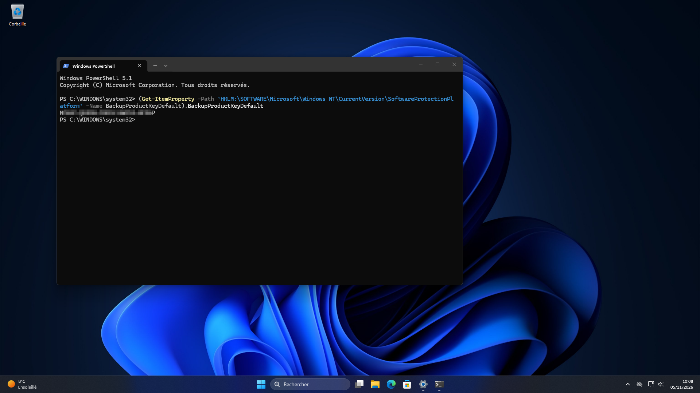

**Récupérer et identifier une licence Windows OEM avant une migration vers Linux**

**Présentation**

Dans le cadre d'un projet personnel de reconditionnement, j'ai décidé de transformer un Dell OptiPlex 3060 SFF, initialement équipé de Windows 11 Professionnel, en serveur de sauvegarde sous Debian 13 XFCE.

Avant de supprimer Windows et de formater le SSD, j'ai souhaité vérifier les informations de licence du système afin de m'assurer qu'une réinstallation ultérieure resterait possible.

Ce tutoriel présente les différentes vérifications effectuées à l'aide de PowerShell.

**Environnement technique**

|Élément|Configuration
|---|---|
|Matériel|Dell OptiPlex 3060 SFF|
|Système initial|Windows 11 Professionnel|
|Outil|Windows PowerShell 5.1|
|Canal de licence identifié|OEM_DM|
|Système de remplacement|Debian 13 XFCE|


## **1. Récupérer la clé de produit Windows**

Windows conserve certaines informations relatives à sa licence dans le registre système.

Pour consulter la clé de produit enregistrée, ouvrir PowerShell et exécuter :
```powershell
(Get-ItemProperty -Path 'HKLM:\SOFTWARE\Microsoft\Windows NT\CurrentVersion\SoftwareProtectionPlatform' -Name BackupProductKeyDefault).BackupProductKeyDefault
```

La commande affiche une clé de produit composée de 25 caractères.



*Important : la clé retournée par BackupProductKeyDefault n'est pas nécessairement la clé OEM intégrée au firmware. Elle peut notamment correspondre à une clé générique.*

Pour consulter directement une éventuelle clé OEM enregistrée dans le firmware UEFI, il existe également cette commande :
```powershell
(Get-CimInstance -ClassName SoftwareLicensingService).OA3xOriginalProductKey
```

## **2. Vérifier l'état d'activation de Windows**

Avant toute réinstallation, il est utile de vérifier que Windows est correctement activé.

La commande suivante permet de consulter l'état d'expiration de l'activation :
```powershell
slmgr /xpr
```

Dans mon cas, Windows affiche :

« L'ordinateur est définitivement activé. »

Cette information confirme l'état d'activation du système au moment du contrôle.

Elle ne permet cependant pas, à elle seule, de déterminer si la licence est transférable vers un autre ordinateur.


## **3. Identifier le type de licence Windows**

Pour obtenir des informations plus détaillées sur la licence, utiliser :
```powershell
slmgr /dlv
```

Cette commande affiche notamment le canal de licence, l'état d'activation et les informations associées au produit.

Sur mon Dell OptiPlex 3060, le canal identifié est :

OEM_DM

Que signifie OEM_DM ?

OEM_DM signifie Original Equipment Manufacturer — Digital Marker.

Ce canal correspond à une licence OEM utilisant une clé intégrée au firmware de l'ordinateur.

Il est fréquemment rencontré sur les ordinateurs professionnels vendus avec Windows préinstallé.

Les principaux types de licences Windows

|Canal|Description|Transfert|
|---|---|---|
|OEM_DM|Licence OEM avec clé intégrée au firmware|Généralement non|
|OEM_COA|Licence OEM associée au matériel d'origine|Généralement non|
|Retail|Licence achetée séparément|Possible sous conditions|
|Volume MAK|Licence destinée aux organisations|Selon contrat|
|Volume KMS|Activation gérée par une organisation|Selon contrat|


## **4. Que devient la licence après installation de Linux ?**

Dans le cas d'une licence OEM_DM, la clé d'origine est enregistrée dans le firmware de la carte mère.

Elle ne dépend donc pas de la présence de Windows sur le SSD.

Il est ainsi possible de :

Supprimer les partitions Windows.

Installer Debian Linux sur le SSD.

Utiliser Linux comme système principal.

Réinstaller ultérieurement Windows sur le même ordinateur.

Lors d'une réinstallation, Windows peut normalement retrouver automatiquement la clé OEM intégrée au firmware, à condition d'installer une édition compatible avec cette licence.

Une licence OEM reste généralement liée à l'ordinateur d'origine et ne peut pas être transférée librement vers un autre PC.


## **5. Conclusion**

Cette vérification m'a permis de confirmer que Windows 11 Professionnel était activé et d'identifier le canal de licence OEM_DM sur mon Dell OptiPlex 3060 SFF.

Je peux donc poursuivre mon projet de migration vers Debian 13 XFCE sans effacer la clé OEM présente dans le firmware.

Cette manipulation constitue également un exercice intéressant pour mieux comprendre :

L'utilisation de PowerShell.

La consultation du registre Windows.

Les mécanismes d'activation de Windows.

Les différences entre licences OEM, Retail et Volume.

Le rôle du firmware UEFI dans la gestion des licences.

Prochaine étape

Installation et configuration de Debian 13 XFCE pour transformer cet ordinateur en serveur de sauvegarde automatisé.

Ressources

Microsoft Learn — Options de Slmgr.vbs

Microsoft — Activation de Windows

Site officiel Debian

Projet personnel d'administration systèmes, de reconditionnement informatique et de découverte des environnements Linux.
